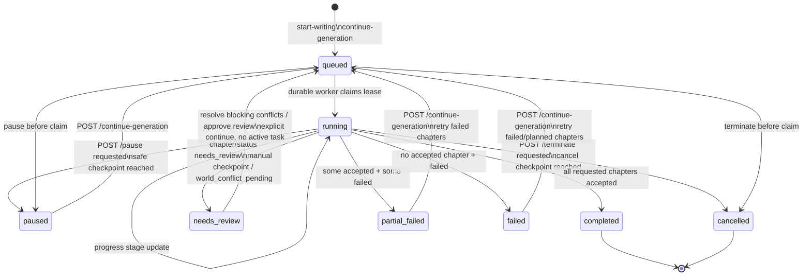
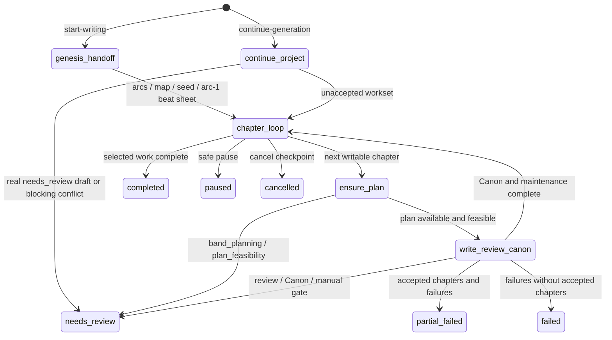
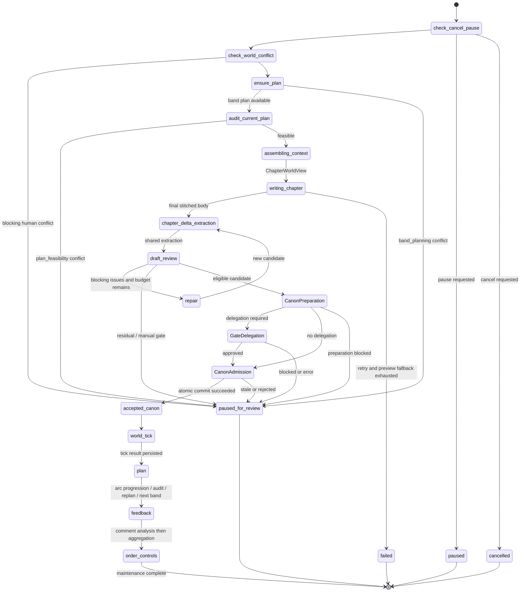
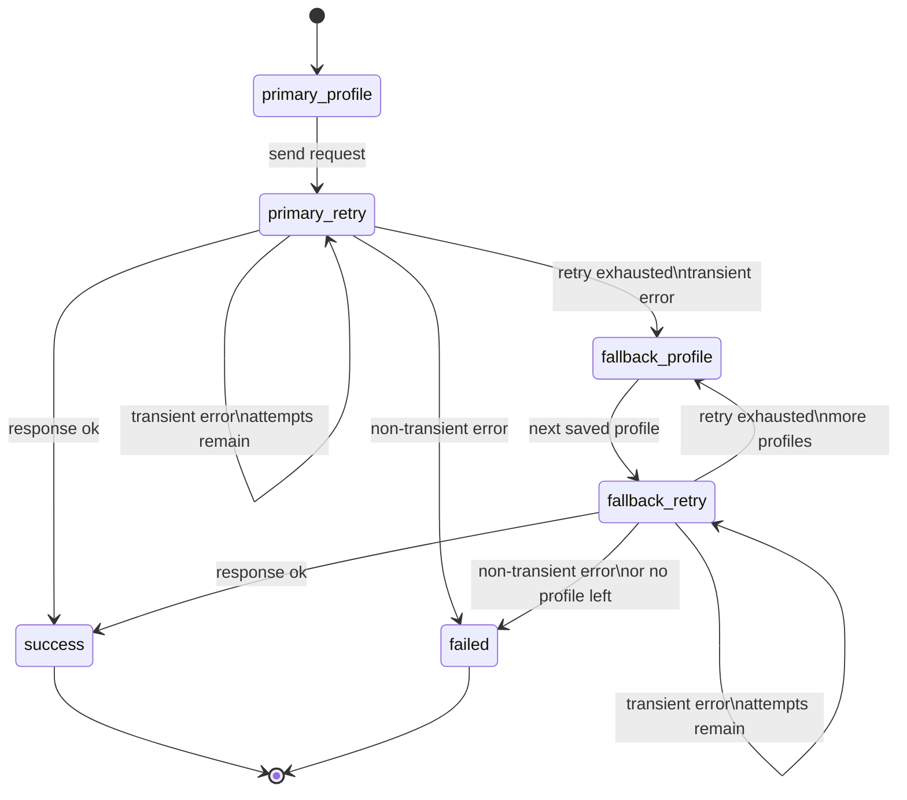

# 写作流程状态机

更新时间：2026-10-25

本文档描述当前代码里的**写作任务**状态机。范围包括 HTTP 入队、durable worker、`start-writing` 后的章节主流程、五层 review、暂停/终止，以及 LLM retry/fallback。

`V2.9.2` 起，“创建书本”已经前移为 Genesis Workflow；Genesis 本身不属于本文档的写作任务状态机。  
本文档只描述 `POST /api/projects/{project_id}/start-writing` 与 `POST /api/projects/{project_id}/continue-generation` 入队后的正式写作任务。已删除的 `/api/generate` 不属于当前状态机。

## 图形版

### 1. API 任务状态机

终态集合：`completed`、`partial_failed`、`failed`、`needs_review`、`cancelled`、`paused`。

### 2. ChapterPipeline 主流程

handoff 只写 arc-1 节拍表和 protection，不生成 ChapterPlan；run control 写前即时规划当前 band。completed arc 的历史重写使用原计划，不重新激活该卷；空 / 退化卷范围没有可写章节并记录 warning。继续操作创建新 durable task，不把旧终态任务改回 queued。

### 3. 单章流水线

`POST_CANON_STEP_NAMES = ("world", "plan", "feedback")`。Canon 接纳先于维护；下一章须等前章三步及 order controls 完成，维护失败不撤销已接纳正文。

### 4. LLM request retry/fallback

2026-10-25 已移除 Codex LLM backend 与 Codex Bridge。所有聊天调用统一经 `LLMClient`，由 `RuntimePolicy.models.chains` 定义逐路由的有序 DeepSeek / Kimi / MiniMax profile fallback chains。

跨模型 fallback 只发生在当前 profile 的单模型 retry 全部耗尽之后。只对 transient 错误 fallback，包括 `429`、`5xx`、`529`、timeout、network disconnect、connection reset 等。不对 `400`、鉴权失败、prompt/schema/JSON 解析失败、内容质量失败、review fail 做跨模型 fallback。

## 文字版

### 任务级状态

`queued`

持久化任务已创建，等待 generation worker claim。API 不启动章节生成线程。

`running`

worker 已 claim lease 并开始推进。`GenerationApplicationService` 根据 progress stage 更新 `current_stage`、`current_chapter`、`completed_chapters`、`failed_chapters`、`paused_chapters`。

`paused`

安全暂停终态。用户调用 pause 后只设置 `pause_requested`，不会中断正在进行的 LLM request；pipeline 在安全 checkpoint 检测到后返回 `RunResult(paused=True)`，任务进入 `paused`。可通过 continue 从未完成章节继续。

`needs_review`

人工 review checkpoint。草稿 review / repair 预算、Canon 冻结或手动 checkpoint 可要求人工处理。open human world conflict 从 `blocks_from_chapter` 起，在写下一章前发出 `paused_for_review`，任务进入 `needs_review`；派生阻断为 `world_conflict_pending`，不要求把已接受章节改成 needs_review。P4a 的 `band_planning` / `plan_feasibility` 也走该路径。continue / review-approve（`continue_generation=true`）在冲突阻断有效时返回 409；解决后仍需显式继续。Generation Audit 是 report-only，不暂停任务。

`cancelled`

强制终止终态。用户调用 terminate 后设置 `cancel_requested`，pipeline 在 checkpoint 检测到后返回 cancelled。与 pause 不同，cancelled 不用于继续。

`failed`

没有任何 accepted 章节，且出现 failed 章节。

`partial_failed`

至少有 accepted 章节，同时存在 failed 章节。

`completed`

本次选择的章节全部接受并完成后置处理。

### 主流程与单章流程

1. `start-writing` 在调用方事务内物化 arcs、map、chapter-0 seed 与 arc-1 `arc_beat_sheets` / protection；成功才锁定 Genesis 并入队，失败整体回滚。
2. worker claim 后通过 `GenerationApplicationService.execute_claimed` 进入 continuation；workset 按顺序列出未接受章节，跳过 accepted，受总章数、有效卷范围和请求上限约束。
3. 每章先检查 pause/cancel、人工冲突与当前卷；`ArcProgressionService` 只向前推进，completed arc 不重新激活。run control 对 active arc 之前的已有行直接复用，包括从未起草的 legacy 行。其余写前由 `BandPlanner.ensure_plan_for_chapter` 准备当前 band 的 `band_plans` / ChapterPlan：accepted/drafted/needs_review 不改；legacy 行（band_plan_id 为空）有草稿 / candidate 历史时保留，从未起草的 legacy planned/failed 行补规划；已有 band-owned 行直接复用，但其中 planned/failed 行即使有草稿历史仍可被后续显式或自动重规划改写。
4. 写前可行性审计检查角色可用性、地点与出行时间、揭示 / protection、writer 文本泄密和 milestone 覆盖；错误持久化为 `plan_feasibility` 冲突并暂停。`band_planning` / `plan_feasibility` 仅向 human 提供 `amend_plan`；PlanAmender 按问题修订节拍表或强制重规划。
5. context 使用 `ChapterWorldView`；writer 分 scene 生成并 stitch。失败仍可调用普通 preview fallback。`<<FORWIN_LOCATION>>` 为视图地点 id 或 `new:<名称>`，抽取仅将其作为 `scene_location_hints`，不作事实证据。
6. `ChapterDeltaExtractor` 按 ChapterWorldView 的实体 / 地点 / 相关秘密从最终 body 抽取，只有 body hash 与 plan fingerprint 同时匹配才复用；draft review / repair 和 CanonPreparation 共享它。`world_consistency` 经 translator / gate 检查时间、移动、角色、物品与揭示，`plan_fulfillment` 提供计划 / 义务履行证据。
7. review、有限 repair 后仍有正文边界违反则先走下述章内冲突；其余先由 residual eligibility 判定资格，再按 `pause.gate_delegate="human"|"llm"` 处理暂停门。`LLMGateDelegate` 使用 `pause_gate` stage，经 `forwin/llm/structured_call.py` 的 `run_structured_llm_call` 调用同一模型链；调用或解析失败时门保持未解决并阻断。CanonPreparation 冻结计划，`CanonAdmissionService.commit_plan` 在事务内重验并原子写入 BookState、实体身份、accepted 状态、审计和 outbox。
8. 依次运行 world → plan → feedback，然后 order controls。plan 审计本 band 剩余计划，按上限重规划，必要时开冲突；band / arc 边界准备下一 band。accepted/drafted/needs_review 计划不改；并发发布只覆盖调用方所见的 band 版本，过期审计延期。
9. feedback 由 `CommentAnalyzer` 先分析评论再聚合。`plan.arc_beats` / `plan.band` 均保存 PromptTrace / LLM DecisionEvents。plan 分别提交卷激活、节拍表、审计 / 重规划及下一 band 工作，最后提交 step 完成状态与 trace outbox；同步 raw-artifact 写失败可使当前单元 / step 失败，重试保留并按条件复用已提交规划工作。事务后 trace outbox 上传失败只重试上传。
10. 下一章重新检查冲突与维护屏障。没有下一计划的 `plot_responds` 保留待回应世界变化，`accept_with_obligation` 保留义务，由后续 band 规划消费并补 `plan_patch:` 引用。

代码 schema head 为 `0006_planning_v6`（父 `0005_world_plan_conflicts`）。卷长按 Genesis 固定，节拍表只切 band；独立 access rules / team speed / edge multipliers 已由出行方式取代（lexicon travel_modes 与 estimate_travel）。完整字段、POV 预算、删除清单与 P4b 实现见 [当前架构](CURRENT_ARCHITECTURE.md)。

world tick 使用 `tick-<commit id>` 与本章故事时间窗口，经过候选收集、逐候选 gate / 一次重试、影响 / 预算、冲突审查、新闻传播与 `WorldTickDeltaBuilder`。提交前按 base candidates → in-tick resolutions 的顺序，在前序已接受变化留下的 runtime / 累计 delta 上复核 hard rules / gate；base 失效以 `constraint_violation` 丢弃，resolution 失效以 `failure_reason="conflict_stale"` 升级人工并保持 open。无补丁且无 resolution 的 quiet tick 不取项目锁；其余在 commit SAVEPOINT 前取项目锁、复核 snapshot，再经 `CanonAdmissionService.commit_world_tick` 写入。LLM 不可用跳过节点；非最新章或已 tick 章跳过；`target_total_chapters > 0` 且本章达到或超过目标时以 `skipped_reason="book_complete"` 跳过。step `result_json` 保存 tick 身份、提交 / 冲突 / 丢弃 / 顺延 ids、warnings、skipped_reason。

历史重写对 plan_constraint 重放 release 时，将 old_value 重置为当前 status，跳过缺失或已 released 的目标；create 保留意图，引用的节点 / fact 缺失则抛 `HistoricalRewriteInvalid` 拒绝整次重写（R20）。world_engine deltas（含直接 `conflict-<id>` resolve）单独走 CAS；失败或依赖已丢弃 tick 的创建引用时退役，产生 `replay_cas` 人工冲突并 supersede 该 delta 承载的 resolutions。原冲突仍为 `resolved`，其未结义务变为终态 `cancelled`（`metadata.cancel_reason`），退出 open 列表、预算和 gate；`planned` / `failed` 计划的关联补丁回撤并记 `plan_patch_revert`，accepted 等其他状态计划不变。同计划其他有效 resolution 仍贡献的目标 / 标记保留，五项上限挤出的旧条目无法恢复。replay_cas 的 `proposed_change` 总含 `superseded_conflict_ids`、`cancelled_obligation_ids`、`reverted_plan_patch_ids`，有 supersede 时摘要给出三项数量。

P4（P4a + follow-up + P4b）已实现，生产部署为独立 Task 14 runbook。`chapter_extraction` 残留冲突保留 needs_review 草稿，提供 `rewrite_chapter` / 人工 `amend_plan`；resolve 后显式 continue，从草稿修复或重审，不重新生成正文。`world_conflict_repair` 有独立预算；critical 交人，其余按 `world.conflict_delegate="llm"|"human"` 处理，从不 auto。世界冲突 reviewer 同样使用 `run_structured_llm_call`，LLM 决定记录 `decider="llm"` 和实际 profile / model；失败或 `amend_plan` 升级人工。控制台展示脱敏 evidence / held change。

最新章重写退役旧 tick，world step 重跑并让受影响 open conflicts 进入 `expired`；更早重写检查消失引用，依赖它的 tick 丢弃并建 replay_cas，非 tick 依赖拒绝重写。`world_variable` / `world.drift`、五种 `checkable` 谓词及幕后新 minor actors 均经 gate / Canon；抽取输入已按 ChapterWorldView 收窄。task_contract_json 与 `narrative_constraints` 已删除，计划用 amend_plan / 重规划 / plan patches 修改。CostLedgerReport 提供按章角色成本 / token、冲突与人工决定、checkpoint 暂停、payload 裁剪及 intent 顺延计数；剩余清理与 P5 调参见 [DESIGN_STATUS](DESIGN_STATUS.md#post-deploy-cleanup)。

### Pause / Continue

Pause 是安全暂停：

1. `POST /api/tasks/{task_id}/pause` 只设置 `pause_requested=True`。
2. 任务仓储会阻止旧的 running/stage 更新覆盖暂停意图。
3. `ChapterPipeline` 在章节边界、context 后、writer 后、review 后、canon 后、post-acceptance 后检查 pause。
4. 检测到 pause 后返回 `paused`，不会把当前未接受章节误标为 accepted。

Continue 的规则：

1. `POST /api/projects/{project_id}/continue-generation` 从已有 project 继续。
2. 如果派生阻断为 `world_conflict_pending` 或存在真实 `needs_review`，返回 409，要求先处理；chapter_extraction 冲突解决后标回 planned，下次继续恢复保存的草稿。冲突读取 `world_plan_conflicts`，任务 / 章节不新增 reason 列。
3. workset 按顺序选未接受章节，包含尚无 ChapterPlan 的章位；planned/failed 可重试，drafted/needs_review 阻塞，写前即时准备 band 计划。
4. 已 `accepted` 章节不会重写。
5. 入队前确认无 active generation task；入队时冻结 RuntimePolicy snapshot，worker claim 后构造 execution context，运行中修改项目策略不影响已启动任务。
6. 冲突恢复使用 `world_conflict_list` / `world_conflict_get` 读状态，经 `world_conflict_resolve` 按提供的选项解决；HTTP 为 `/api/projects/{id}/world-conflicts[/{cid}[/resolve]]`，控制台 task drawer 同样接入。重读项目并确认无阻断 / active task 后显式 continue，resolve 本身不启动任务。直接 resolve 在冲突行锁后取得项目锁，锁内读取 canon / news queue 并重查选项；变化不再成立返回 `ConflictStale`（HTTP/MCP 409），Canon 拒绝写入也返回 409，事务不关闭冲突。veto 不受 held change 失效影响；其他选项失败后应重读冲突与当前 canon 再决定。旧 CanonQualitySignal 使用 `world_model_signal_list`。

### Review / Approve

1. `GET /api/projects/{project_id}/chapters/{chapter_number}/review` 读取最新 draft 对应 review。
2. Review 详情分别显示 `draft_review`、`repair`、`residual_eligibility`、`gate_delegation`、`canon`；前四层通过不等于 Canon 已提交。
3. `POST /review/approve` 请求 `continue_generation=true` 时先检查派生阻断，有效 `world_conflict_pending` 返回 409；接受路径仍要求 `CanonAdmissionService.commit_plan` 成功后章节才成为 `accepted`。
4. 如果请求 `continue_generation=true`，approve 后创建 continue task，继续剩余 `planned/failed` 章节。

### 状态来源

核心代码位置：

1. HTTP runtime 与任务终态：`forwin/http/runtime.py`
2. durable task 入队与执行：`forwin/application/generation.py`
3. progress stage 到任务 status：`forwin/application/generation_execution.py`
4. run/continue/chapter loop：`forwin/generation/pipeline_core/`
5. draft review/repair/residual：`forwin/review/`
6. Canon 准备与原子提交：`forwin/canon/`
7. LLM retry/fallback：`forwin/writer/llm/`
8. 世界 tick / 冲突 / 维护顺序：`forwin/world_engine/`、`forwin/maintenance/events.py`、`forwin/maintenance/post_canon.py`
