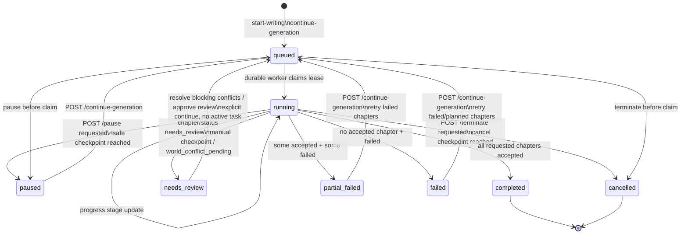
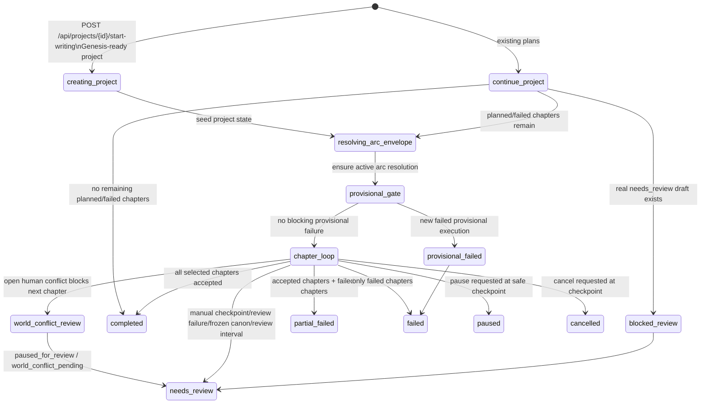
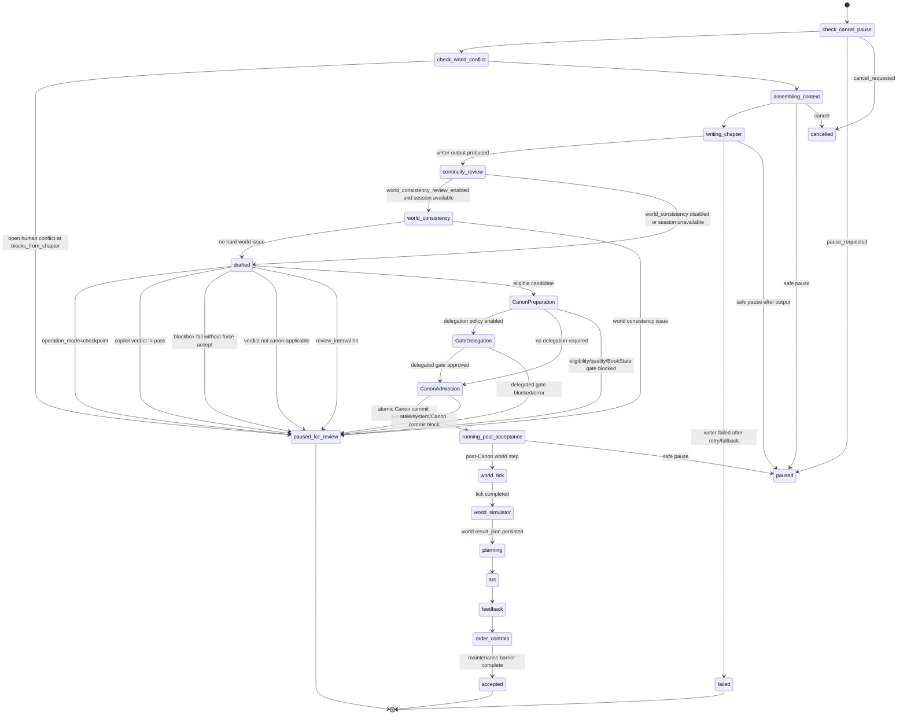
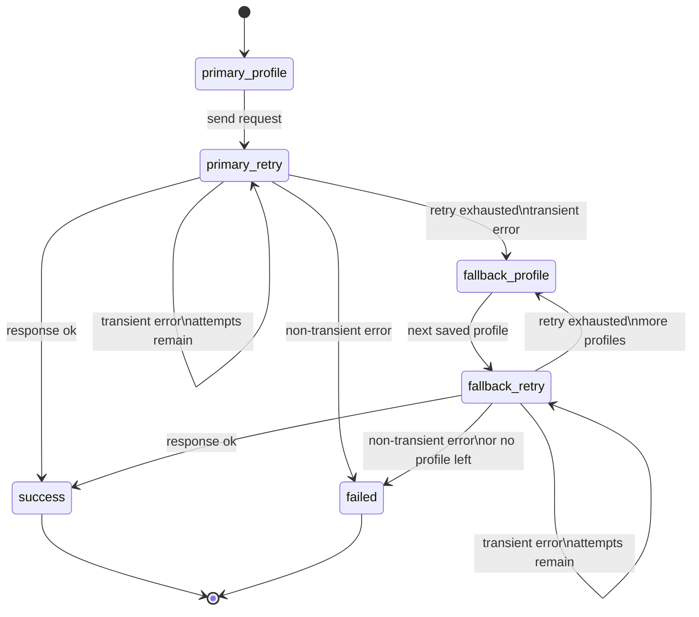

# 写作流程状态机

更新时间：2026-10-22

本文档描述当前代码里的**写作任务**状态机。范围包括 HTTP 入队、durable worker、`start-writing` 后的章节主流程、五层 review、暂停/终止，以及 LLM retry/fallback。

`V2.9.2` 起，“创建书本”已经前移为 Genesis Workflow；Genesis 本身不属于本文档的写作任务状态机。  
本文档只描述 `POST /api/projects/{project_id}/start-writing` 与 `POST /api/projects/{project_id}/continue-generation` 入队后的正式写作任务。已删除的 `/api/generate` 不属于当前状态机。

## 图形版

### 1. API 任务状态机

终态集合：`completed`、`partial_failed`、`failed`、`needs_review`、`cancelled`、`paused`。

### 2. Orchestrator 主流程

### 3. 单章流水线

### 4. LLM request retry/fallback

跨模型 fallback 只发生在当前 profile 的单模型 retry 全部耗尽之后。只对 transient 错误 fallback，包括 `429`、`5xx`、`529`、timeout、network disconnect、connection reset 等。不对 `400`、鉴权失败、prompt/schema/JSON 解析失败、内容质量失败、review fail 做跨模型 fallback。

## 文字版

### 任务级状态

`queued`

持久化任务已创建，等待 generation worker claim。API 不启动章节生成线程。

`running`

worker 已 claim lease 并开始推进。`GenerationApplicationService` 根据 progress stage 更新 `current_stage`、`current_chapter`、`completed_chapters`、`failed_chapters`、`paused_chapters`。

`paused`

安全暂停终态。用户调用 pause 后只设置 `pause_requested`，不会中断正在进行的 LLM request；pipeline 在安全 checkpoint 检测到后返回 `RunResult(paused=True)`，任务进入 `paused`。可通过 continue 从未完成章节继续。

`needs_review`

人工 review checkpoint。P3 还会在 open human world conflict 的 `blocks_from_chapter` 起、写下一章前发出 `paused_for_review`，任务进入 `needs_review`；派生阻断为 `world_conflict_pending`，不要求把已接受章节改成 needs_review。continue / review-approve（`continue_generation=true`） 在该阻断仍有效时返回 409；解决冲突后仍需显式继续。

`cancelled`

强制终止终态。用户调用 terminate 后设置 `cancel_requested`，pipeline 在 checkpoint 检测到后返回 cancelled。与 pause 不同，cancelled 不用于继续。

`failed`

没有任何 accepted 章节，且出现 failed 章节或 provisional gate 失败。

`partial_failed`

至少有 accepted 章节，同时存在 failed 章节。

`completed`

本次选择的章节全部接受并完成后置处理。

### 主流程

1. 新项目必须先完成并锁定 Genesis；`start-writing` 从 Genesis blueprint 物化项目与当前 active arc 的 `ChapterPlan`，然后创建 durable generation task。
2. generation worker claim 任务后，由 `GenerationApplicationService.execute_claimed` 构造不可变 execution context，并进入 project-backed continuation。
3. `resolving_arc_envelope` 保证 active arc resolution 存在；provisional/scenario 检查产生显式阻断状态。
4. chapter loop 只处理当前 workset 的 `planned` 和 `failed` 章节，不重写 accepted 章节。
5. 真实 `needs_review` 章节会阻塞 continue；处理 review 后可显式创建下一条 continuation task。
6. 当前 arc 无 pending work 时，planning service 可物化下一条已批准 arc，再由新的 durable task 继续。

### 单章流程

1. 每章开始先检查 cancel 和 pause。
2. `assembling_context` 组装章节上下文。
3. `writing_chapter` 调 writer。writer 内部会按单模型 retry，必要时由 LLMClient 做跨 profile fallback。
4. writer 失败后尝试 preview fallback；仍失败则章节标为 failed。
5. `continuity_review` 调 `DraftReviewService`/`ContinuityChecker`，保存 draft 和 review；`world_consistency` 信号复用候选的 chapter delta，经 `ChapterDeltaTranslator` 与 `BookStateReviewGate` v6 检查时间、已知路径、移动速度、角色状态、物品与揭示。旧 `MapMovementReviewer` 已删除；移动时间现共用 `estimate_travel` 与本书 travel modes；独立的 access rules、team speed、edge multipliers 检查明确推迟到 P4；认知图的 `false_edges` 已参与路径查询。
6. 根据 operation mode 和 verdict 判断：
   - `checkpoint`：总是 `needs_review`。
   - `copilot`：`pass` 才继续，`warn/fail` 进入 `needs_review`。
   - `blackbox`：`fail` 且没有 force accept 时进入 `needs_review`；`pass/warn/force_accept` 可进入 canon。
7. 如果 `review_interval_chapters > 0` 且当前章节命中周期，并且不是本次最后一章，在 canon 前把当前章标为 `needs_review`。
8. `CanonPreparationService` 在事务外冻结 eligibility、quality、EntityAdmissionPlan 与经 `BookStateReviewGate` 批准的 GraphDelta。
9. 配置 gate delegation 时，`GateDelegationService` 产生独立批准/阻断事件；没有 delegation 时明确记录为未委托，而不是伪造通过。
10. `CanonAdmissionService.commit_plan` 在单事务内重验 candidate、提交 BookState/GraphDelta/snapshot、实体身份、审计和 outbox；只有事务成功才将章节标记为 `accepted`。
11. `running_post_acceptance` 触发可重试维护 / outbox。`POST_CANON_STEP_NAMES = ("world", "planning", "arc", "feedback")`；world 先 `WorldTickService.run` 后旧 `WorldSimulator`，四步之后执行 order controls。Knowledge Projection、memory index 与发布侧投影仍从 Canon 派生，失败不回滚已提交 Canon。
12. accepted 章节加入 `completed_chapters`；下一章运行前读取 open human conflicts。`blocks_from_chapter <= next_chapter` 时停止 chapter loop、发出 `paused_for_review`，不开始该章正文生成。

world tick 使用 `tick-<commit id>` 与本章故事时间窗口，经过候选收集、逐候选 gate / 一次重试、影响 / 预算、冲突审查、新闻传播与 `WorldTickDeltaBuilder`，最后经 `CanonAdmissionService.commit_world_tick` 写入。LLM 不可用跳过节点；非最新章或已 tick 章跳过，历史重写则 CAS 重放 tick deltas，失败产生 `replay_cas` 人工冲突。step `result_json` 保存 tick 身份、提交 / 冲突 / 丢弃 / 顺延 ids、warnings、skipped_reason，另附模拟器 pressure_level。

### Pause / Continue

Pause 是安全暂停：

1. `POST /api/tasks/{task_id}/pause` 只设置 `pause_requested=True`。
2. 任务仓储会阻止旧的 running/stage 更新覆盖暂停意图。
3. `ChapterPipeline` 在章节边界、context 后、writer 后、review 后、canon 后、post-acceptance 后检查 pause。
4. 检测到 pause 后返回 `paused`，不会把当前未接受章节误标为 accepted。

Continue 的规则：

1. `POST /api/projects/{project_id}/continue-generation` 从已有 project 继续。
2. 如果派生阻断为 `world_conflict_pending` 或存在真实 `needs_review`，返回 409，要求先处理。冲突读取 `world_plan_conflicts`，任务 / 章节不新增 reason 列。
3. 只运行 `planned` 和 `failed` 章节。
4. 已 `accepted` 章节不会重写。
5. 入队前确认无 active generation task；入队时冻结 RuntimePolicy snapshot，worker claim 后构造 execution context，运行中修改项目策略不影响已启动任务。
6. 冲突恢复使用 `world_conflict_list` / `world_conflict_get` 读状态，经 `world_conflict_resolve` 按提供的选项解决；HTTP 为 `/api/projects/{id}/world-conflicts[/{cid}[/resolve]]`，控制台 task drawer 同样接入。重读项目并确认无阻断 / active task 后显式 continue，resolve 本身不启动任务。旧 CanonQualitySignal 使用 `world_model_signal_list`。

### Review / Approve

1. `GET /api/projects/{project_id}/chapters/{chapter_number}/review` 读取最新 draft 对应 review。
2. Review 详情分别显示 `draft_review`、`repair`、`residual_eligibility`、`gate_delegation`、`canon`；前四层通过不等于 Canon 已提交。
3. `POST /review/approve` 请求 `continue_generation=true` 时先检查派生阻断，有效 `world_conflict_pending` 返回 409；接受路径仍要求 `CanonAdmissionService.commit_plan` 成功后章节才成为 `accepted`。
4. 如果请求 `continue_generation=true`，approve 后创建 continue task，继续剩余 `planned/failed` 章节。

### 状态来源

核心代码位置：

1. HTTP runtime 与任务终态：`forwin/http/runtime.py`
2. durable task 入队与执行：`forwin/application/generation.py`
3. progress stage 到任务 status：`forwin/application/generation_execution.py`
4. run/continue/chapter loop：`forwin/generation/pipeline_core/`
5. draft review/repair/residual：`forwin/review/`
6. Canon 准备与原子提交：`forwin/canon/`
7. LLM retry/fallback：`forwin/writer/llm/`
8. 世界 tick / 冲突 / 维护顺序：`forwin/world_engine/`、`forwin/maintenance/events.py`、`forwin/maintenance/post_canon.py`
